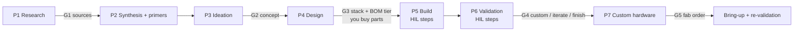

# Smart Insoles: agent harness

A **Claude Code agent harness** that researches, designs and builds a **smart insole for running
and sport gait analysis** on top of existing open-source projects and research papers. As it
goes, it writes a **tutorial series for software developers who have little hardware or medical
background**.

It lives in its own folder and is independent of the Ralph scripts at the repository root. It does
borrow Ralph's core idea: state lives in files and git, each task gets a fresh context, and
lessons learned are kept as guardrails.

> Not a medical device. The project estimates running metrics for training insight; it does not
> diagnose, treat or prevent anything. See `docs/start-here/safety-and-disclaimer.md`.

## Quick start

```bash
cd smart-insoles          # always start Claude Code from this folder, so its hooks and agents load
claude
```

On first launch, **accept the workspace trust dialog**. Until you do, Claude Code ignores this
folder's permission allowlist, so headless runs (`claude -p`, autopilot) can't run even routine
commands. Then type:

```
/project-status      # where are we?
/next                # do the next task (one per session, then /clear and /next again)
```

Requirements: [Claude Code](https://code.claude.com), git, and Python 3.9+ for the harness tools
(stdlib only). From phase P5 on, you'll need whatever toolchain is chosen at gate G3 (e.g.
PlatformIO or Zephyr), Node.js for the dashboard, and Python 3.11+ for `gaitlab`.

## How it works



- **The lead** is your main Claude Code session, configured by `CLAUDE.md`. It reads the state,
  picks the next task (`scripts/harness.py next`), delegates to a specialist subagent, checks the
  result, writes a build-journal entry, and commits.
- **Ten specialist agents** in `.claude/agents/`: research-scout, literature-analyst,
  product-ideator, gait-scientist, hardware-engineer, firmware-engineer, software-engineer,
  tutorial-writer, novice-reviewer and safety-claims-reviewer.
- **Seven knowledge skills** in `.claude/skills/`, preloaded into the agents that need them:
  tutorial-style, source-evaluation, gait-metrics, hardware-safety-and-claims, au-sourcing,
  hardware-in-the-loop and data-handling.
- **Gates stop the agents and wait for you:**
  - G1: source shortlist
  - G2: concept and requirements
  - G3: design freeze, stack and BOM tier, before you buy anything
  - every hardware-in-the-loop step you perform
  - G4: go custom / iterate / finish
  - G5: fabrication order
- **Tutorials** are produced continuously. Agents journal in `docs/journal/`, the tutorial-writer
  turns each finished phase into chapters (`docs/chapters/`) and notebooks (`docs/notebooks/`),
  and three reviewers check every chapter. Each hardware chapter has a simulation path and a
  real-hardware path.

### Your commands

| Command | What it does |
|---|---|
| `/next [TASK]` | Advance one step: a task, or up to the next gate or hardware step |
| `/project-status` | Phases, gates, waiting items, next action |
| `/approve <G> [option] [notes]` | Approve a gate (G4 needs `custom`, `iterate` or `finish`) |
| `/reject <G> <what to change>` | Send a gate back with notes; agents rework and resubmit |
| `/hil [TASK]` | Show the hardware step(s) waiting for you, as a bench checklist |
| `/hil-done <TASK> [observations]` | Report a hardware step completed; agents verify the evidence |
| `/hil-failed <TASK> <what happened>` | Report a problem; agents troubleshoot and revise the steps |
| `/tutorial <A1 or P2>` | Write or refresh chapter(s), then review them |
| `/review-tutorial <chapter>` | Novice + domain + safety review, then fixes |
| `/sign <lesson>` | Add a guardrail so future sessions avoid a mistake |

**Only you can decide.** A `UserPromptSubmit` hook records a decision from the command you
actually typed (`/approve`, `/reject`, `/hil-done`, `/hil-failed`) into
`state/gates/decisions.jsonl`. Agents are blocked from writing that file by a guard hook and a
permission deny rule. Writing "looks good" in chat does not approve anything.

### Mechanical guardrails

- `.claude/hooks/guard.py` blocks agents from forging decisions and from committing your raw
  recordings (`data/raw/` is gitignored, and force-adding it or committing it is refused).
- `.claude/settings.json` pre-approves routine commands (harness tools, tests, docs build, git
  add/commit, firmware builds, research sites). It **asks** before flashing firmware or
  `git push`, and **denies** force-push.
- `.claude/hooks/session_start.py` puts the current status into every new session.

### Optional: autopilot

```bash
scripts/autopilot.sh -n 5 --budget 3
```

This runs `claude -p "/next"` in a loop, with a fresh context each iteration. It stops at the
first gate or hardware step that needs you, when everything is done, or after two iterations
without a commit. Logs go to `logs/` (gitignored). It needs the trust dialog to have been
accepted once (see Quick start). Headless runs can't answer permission prompts, so flashing is
always left to an interactive session.

## Folder map

```
smart-insoles/
├── CLAUDE.md                 lead-agent operating manual (session protocol, rules)
├── .claude/
│   ├── agents/               10 specialist subagents
│   ├── skills/               slash commands + knowledge skills
│   ├── hooks/                session brief, human-decision recorder, guard
│   └── settings.json         permissions + hook wiring
├── state/
│   ├── BRIEF.md              project charter (from the owner interview)
│   ├── workflow.json         phases and gates
│   ├── backlog.md            task queue (the agents' to-do list)
│   ├── guardrails.md         lessons learned ("signs")
│   ├── gates/  hil/          gate packets, HIL instructions, decisions.jsonl (human-only)
│   ├── reviews/              reviewer reports
│   └── templates/            gate, HIL, ADR, journal templates
├── research/                 sources.yaml registry, search log, notes, synthesis
├── ideation/  design/        personas → requirements; designs, BOM, ADRs
├── firmware/  software/      created after G3 (firmware, gaitlab, dashboard)
├── hardware/  validation/    build docs; validation plan/report
├── data/                     raw/ (local only), samples/ (published), public/ (cache)
├── docs/  mkdocs.yml         the tutorial site
└── scripts/                  harness.py, lit_search.py, autopilot.sh, smoke_test.sh, tests/
```

## Tutorial site

```bash
python3 -m venv .venv && source .venv/bin/activate
pip install -r requirements-docs.txt
mkdocs serve        # http://127.0.0.1:8000
```

The site uses MkDocs Material, which its maintainers support until 2027-05-05. Its successor,
[Zensical](https://zensical.org), reads the same `mkdocs.yml` if you migrate later.

## Checking the harness

```bash
bash scripts/smoke_test.sh            # unit tests, validation, settings, docs build
python3 scripts/harness.py validate   # state consistency only
```

## Licences

Code: [MIT](LICENSE). Tutorials, docs and sample data: [CC BY 4.0](LICENSE-docs.md). Third-party
sources keep their own licences; see `research/sources.yaml` and `docs/reference/sources.md`.
