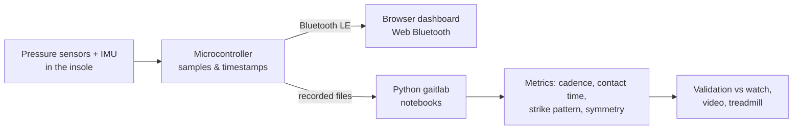

# Smart Insoles from Scratch

**Build a smart insole that analyses how you run, starting from open-source projects and research
papers. Written for software developers who have never built hardware and never studied
biomechanics.**

!!! warning "Work in progress"
    This series is written *while* the project is being built, by a team of AI agents working with
    a human maker. Chapters appear as each phase finishes. The [curriculum map](chapters/index.md)
    shows what exists today.

## What you'll build

A pair of instrumented insoles that measure **plantar pressure** (how hard each part of your foot
presses down) and **motion**, stream the data over Bluetooth Low Energy to a browser dashboard, and
estimate running metrics such as **cadence**, **ground contact time**, **foot-strike pattern** and
**left/right symmetry**. Then we check those estimates against a running watch, slow-motion video
and a treadmill.

## Who this is for

You write software for a living. You know Python or TypeScript, git and the command line. You
**don't** need to know what an ADC is, how to solder, or what "stance phase" means. We teach each of
those from what you already know.

## Two ways to follow along

Every hands-on chapter has two tabs:

- **Simulation path**: no hardware. You use an online microcontroller simulator, recorded sensor
  data and notebooks.
- **Hardware path**: you build the real thing, with an Australian parts list in budget, standard and
  premium tiers.

Start with [Start here](start-here/index.md), then follow the [curriculum](chapters/index.md).

!!! danger "Not a medical device"
    This project is for learning and training insight. It does not diagnose, treat or prevent any
    injury or condition. Read [Safety and disclaimer](start-here/safety-and-disclaimer.md) before
    building anything.
